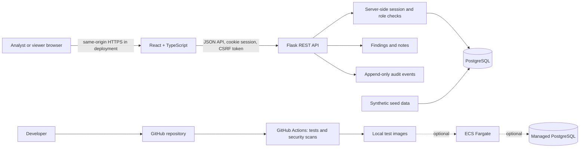

# Architecture

## Purpose and scope

The Cloud Security Findings Tracker is a compact, single-application portfolio project. It presents synthetic cloud-security findings, supports analyst investigation and status updates, and records a history of those actions. It is not a SIEM, alert detector, multi-tenant service, or automated response system.

The local application must be testable without an AWS account. AWS is an optional later deployment target and remains outside this milestone.

## Components

The planned ECS path is not part of the local runtime, and no AWS infrastructure is included in this foundation.

## Trust boundaries

1. **Browser to application:** the browser is untrusted. The API validates every field, authenticates every protected request, checks the user's role on every action, and applies CSRF protection to cookie-authenticated state changes.
2. **Application to PostgreSQL:** the API uses a least-privilege database identity. Queries are parameterized through SQLAlchemy. The database stores passwords only as Argon2id hashes and stores server-side session state separately from browser cookies.
3. **Developer and dependency supply chain:** pull requests run tests, code analysis, dependency auditing, full-history secret scanning, and container scans. Actions and scanner archives are pinned; jobs have read-only repository permissions and bounded execution. The active `Protect main` ruleset enforces these checks before merging. Infrastructure checks follow when Terraform is introduced; see [CI policy](ci-security.md).
4. **Optional AWS boundary:** only a later, separately reviewed milestone may add cloud resources. Local tests and CI do not need AWS credentials.

## Request flow

- The browser loads the React single-page application. Vite proxies /api during local development; a later deployment will serve the frontend and API from one origin.
- The browser obtains an anti-CSRF token and sends it in the X-CSRFToken header for state-changing requests.
- Flask resolves the opaque session cookie against migration-managed PostgreSQL session storage. The database stores a hash of the cookie identifier; the current user and role are loaded from the user record rather than trusted from browser-provided fields.
- Authorization and input validation run before business operations.
- A finding update or note creation and its audit event are committed in one database transaction.
- API errors use stable RFC 9457 problem details and do not reveal stack traces, credentials, or SQL information.

## Milestone 2 implementation notes

- The API stores only synthetic findings and exposes no event-ingestion or delete endpoints.
- Finding status changes and note creation write their audit event in the same transaction.
- Session payloads use strict JSON serialization; session identifiers are rotated at login and invalidated at logout.
- Readiness checks PostgreSQL and the required migrated tables. Liveness does not depend on the database.

## Availability checks

- GET /api/v1/health/live reports that the process is running. It performs no dependency checks and returns no environment or secret details.
- GET /api/v1/health/ready returns success only when the database is reachable and the required migrated tables exist; otherwise it returns a generic service-unavailable response.

## Runtime baseline

As checked on 2026-10-28, the development baseline is Python 3.12.14, Node.js 24 LTS, and PostgreSQL 18.6. These versions are recorded so the local skeleton is repeatable; update to current security patches within each supported major/minor line. The PostgreSQL project supports each major release for five years.

## Explicit exclusions

- Real cloud or identity-provider event ingestion
- Automated blocking, account changes, or incident response
- User self-registration and multi-tenancy
- SSO, MFA, and external identity federation
- Public internet exposure before the deployment threat review
- AWS resources, live deployment, or cloud credentials in local setup

## References

- [Node.js release schedule](https://nodejs.org/en/about/previous-releases)
- [Python version support](https://devguide.python.org/versions/)
- [PostgreSQL versioning policy](https://www.postgresql.org/support/versioning/)
- [Flask configuration](https://flask.palletsprojects.com/en/stable/config/)

