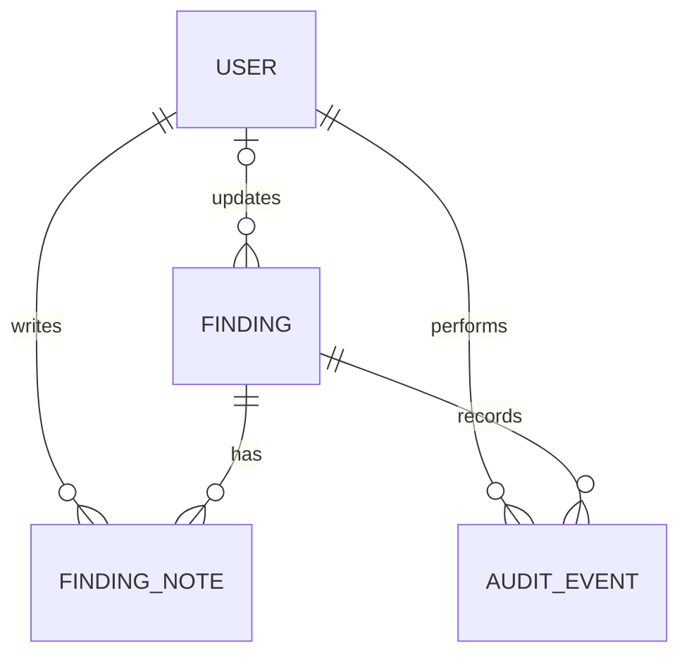

# Data model

All records belong to one local project workspace. The first release is single-tenant and uses synthetic findings. PostgreSQL is the source of truth.

## Entities

### User

| Field | Type and rule |
|---|---|
| id | UUID primary key |
| username | Normalized text, unique, 3-64 characters |
| password_hash | Argon2id encoded hash; never return or log |
| role | analyst or viewer |
| is_active | Boolean; inactive users cannot authenticate |
| created_at, updated_at | UTC timestamps |

Users are created through a local administrative setup command, not a public registration route. Passwords are never stored in plaintext. The role is read from the user record on each protected request. The setup command requires a 12- to 128-character password and accepts only normalized 3- to 64-character usernames.

### Finding

| Field | Type and rule |
|---|---|
| id | UUID primary key |
| source | Short validated identifier such as cloudtrail, guardduty, or demo |
| source_event_id | Nullable source identifier; unique together with source when present |
| title | Required plain text, 1-200 characters |
| description | Plain text, maximum 4,000 characters |
| evidence_summary | Plain text, maximum 4,000 characters |
| metadata | JSON object containing only allowlisted, non-secret fields; maximum serialized size 16 KiB |
| severity | critical, high, medium, low, or informational |
| status | new, investigating, resolved, or dismissed |
| observed_at | UTC timestamp for the represented event |
| resolution_reason | Nullable plain text, required for resolved and dismissed, maximum 1,000 characters |
| created_at, updated_at | UTC timestamps |
| updated_by | Nullable foreign key to User |
| version | Positive integer incremented on each status update |

An index supports filtering by status, severity, observed_at descending, and ID descending. A uniqueness constraint on source and source_event_id applies only when the source event ID is present. No raw cloud-provider payload is stored or returned in v1.

### FindingNote

| Field | Type and rule |
|---|---|
| id | UUID primary key |
| finding_id | Required foreign key to Finding |
| author_id | Required foreign key to User |
| body | Required plain text, 1-4,000 characters |
| created_at | UTC timestamp |

Notes are append-only through the API. Editing or deleting notes is not supported in v1.

### AuditEvent

| Field | Type and rule |
|---|---|
| id | UUID primary key |
| finding_id | Required foreign key to Finding |
| actor_id | Required foreign key to User |
| event_type | finding.status_changed or finding.note_added |
| occurred_at | UTC timestamp |
| details | Small JSON object containing only safe event fields |
| request_id | Nullable UUID for correlating application logs |

A status-change event stores the prior and new status, version, and optional resolution reason. A note-added event stores the note ID, not a second copy of its body. Audit rows are inserted in the same transaction as their corresponding change. The runtime application identity must not update or delete audit rows.

### ServerSession

Flask-Session owns the server-side session lifecycle. The migration-managed `server_sessions` table stores a SHA-256 hash of the opaque random session ID, JSON session data, and an expiry timestamp. Session data contains only the minimum authentication and CSRF state plus an absolute expiry. The cookie and server record use a 30-minute sliding idle lifetime capped by an eight-hour absolute lifetime. Schedule `flask session_cleanup`; the browser cookie does not contain application session data.

### AuthThrottleBucket

| Field | Type and rule |
|---|---|
| key_hash | HMAC-SHA-256 primary key derived from normalized username, client address, and the application secret |
| window_started_at | UTC timestamp for the current failure window |
| failures | Non-negative failed-login count |

Raw usernames and client addresses are not stored in this table. Expired buckets are removed during login requests. The current local limit is ten failures in fifteen minutes; a later public deployment must review edge rate limits and trusted proxy configuration.

## Relationships

## Integrity and lifecycle rules

- Finding status transitions are enforced by the API, not by the frontend.
- Every accepted status change and note creation has exactly one audit event in the same transaction.
- Failed database transactions must not leave a finding update without its audit event, or an audit event without its corresponding update.
- User accounts are deactivated rather than deleted when retained records still reference them.
- Findings are not hard-deleted in v1.
- All timestamps are timezone-aware UTC.
- Raw event bodies, secrets, session IDs, cookies, and passwords are never stored in metadata or audit details.

