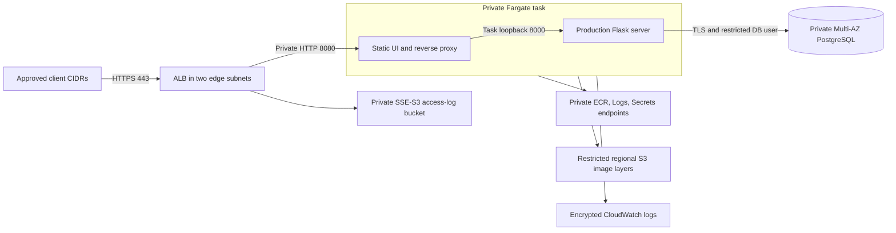

# Optional deployment and operations

## Current status

The Terraform foundation defines the ECS Fargate path and is validated through formatting, provider-schema validation, mocked security tests, and static infrastructure scanning. No AWS stack exists as a result of this work. No image is published, no secret value is created, and no live plan, apply, migration, or teardown has been run.

The default Dockerfiles and Compose stack remain for local development. Separate production image definitions run Gunicorn and a static Nginx frontend; the [local verification guide](production-images.md) exercises them over HTTPS and database TLS. These local checks do not establish that a live AWS deployment, permissions, or teardown work.

See [ADR 0003](decisions/0003-optional-ecs-foundation.md) for resource choices, limitations, and the two expiring scanner exceptions. See the [Terraform README](../infra/terraform/README.md) for commands that validate without AWS credentials.

## Intended path

The frontend and API share a task boundary and task role. Only the frontend port is reachable from ALB. There is no NAT gateway, public task address, direct API ingress, database ingress from clients, or general task internet route. AWS service calls are restricted to the private endpoints and the ECR layer bucket. Database subnets have no internet route.

## Prerequisites before live AWS work

1. Owner approval must explicitly cover the target account, region, spending limit, expected lifetime, and teardown/retention plan. The sample region and account in the test fixture are not a live selection.
2. Review current regional service pricing, quotas, AZ names, RDS PostgreSQL 18 patch availability, instance-class support, and the existing certificate. Mocked tests do not establish any of these.
3. Establish encrypted, access-controlled remote state with locking and a recovery procedure. This code configures no backend. Terraform state and saved plans may contain sensitive metadata even when secret values are kept outside Terraform.
4. Prepare least-privilege operator roles and separate roles for any image publication, migrations, and application activation. CI has no AWS role, credentials, or deployment permissions; no GitHub Actions OIDC deployment trust is created here.
5. Rebuild, review, and scan the production image definitions, then obtain separate publication approval. Use immutable digests from the two ECR repositories. Repository creation and image publication are separate operations; tasks remain at zero while artifacts are prepared.
6. Prepare dedicated live migration and runtime database identities using the grant model verified in [ADR 0004](decisions/0004-production-serving-and-local-tls.md). The runtime identity must not own schema or update/delete audit events. The local grant helper is deliberately restricted to the disposable test database; it is not a live provisioning tool. Production startup runs no migration or seed command.
7. Populate the application secret outside Terraform with DATABASE_URL and SECRET_KEY. Use the runtime database user and verified TLS. Never use the RDS administrator as the application user. Define runtime credential rotation and task restart procedures; RDS administrator rotation does not rotate a separately created application user's password.
8. Verify the implemented host, proxy-hop, Secure-cookie, browser-header, TLS, and log controls against the actual certificate/DNS, client CIDRs, and ALB configuration. APP_HOST must be identical in both images and match the reviewed application_hostname Terraform input. Review edge limits and account creation. No real telemetry or production user data belongs in this demonstration.
9. Define alerts and response ownership for failed deployments, unhealthy targets, database/storage issues, authentication abuse, costs, and expiring exceptions. CloudWatch logs and Container Insights provide evidence; they do not by themselves configure operational alerts.
10. Review a real saved plan with the owner before provisioning. Activation is another explicit step after the stack, artifacts, secret, migrations, and exposure controls have been verified.

## Production image contract

| Area | Required behavior before activation |
|---|---|
| API | The production image runs Gunicorn on task loopback port 8000 and preserves health endpoints. It excludes the development entrypoint, migrations on startup, and management control socket. |
| Frontend | The production image serves compiled assets on 8080 and proxies /api to 127.0.0.1:8000. It includes wget and /healthz, and excludes Vite, Node, npm, and source files. |
| Identity/filesystem | Both images must support UID/GID 10001, read-only roots, dropped capabilities, and /tmp as their only mounted writable path. Configure proxy caches/PID/temp files accordingly. |
| Database | Startup requires sslmode=verify-full and an existing absolute CA file. The image contains the [public RDS CA snapshot](../backend/certs/README.md); verify its freshness before deployment. Never disable certificate verification to pass a smoke test. |
| Browser/edge | Explicit Host validation, bounded proxy trust, Secure/HttpOnly/SameSite cookies, CSRF, CSP, and browser headers are implemented. Verify the live network/header path before exposure. ALB-to-task HTTP is a documented private-boundary tradeoff, not end-to-end TLS. |
| Secrets/logs | Resolve the two ECS-injected secrets at startup; fail closed when absent. Do not log credentials, cookie values, CSRF tokens, or request bodies containing secrets. |
| Release checks | Test analyst and viewer workflows, CSRF rejection, stale writes, inert HTML-like notes, logout, header behavior, and health failures against the production images before activating a live service. |

Terraform task settings align with these production variants. The local fixture checks their runtime and HTTP behavior; development variants do not satisfy this contract, and no live ECS behavior has been tested.

## Cost review

A zero desired task count still leaves chargeable services if the stack is provisioned. Prepare an estimate for the approved region and lifetime; do not assume free-tier eligibility.

| Component | Cost inputs to review |
|---|---|
| ECS Fargate | Task CPU/memory, running hours, deployment overlap, and data transfer. The configuration declares 0.5 vCPU/1 GiB per task and permits up to two tasks. |
| ALB | Load balancer hours, capacity units, transfer, and public IPv4 addresses. |
| Private endpoints | Four interface services in two AZs: eight interface-endpoint AZ-hours per elapsed hour, plus processed data. The S3 gateway has a different charging model. No NAT gateway is configured. |
| RDS | Multi-AZ db.t4g.micro availability/pricing, PostgreSQL 18 support, 20 GiB gp3 allocation, potential growth to 100 GiB, backups/snapshots, and database monitoring. |
| Storage/observability | ECR storage/scans, S3 access logs and versions, CloudWatch ingestion/retention/Insights, customer-managed KMS, and Secrets Manager secrets/rotation. |
| Retained resources | Final snapshots, keys, logs, secrets in recovery, registries, and remote state can remain chargeable after tasks stop. |

Current price sources must be checked during the approval review: [Fargate](https://aws.amazon.com/fargate/pricing/), [load balancing](https://aws.amazon.com/elasticloadbalancing/pricing/), [PrivateLink](https://aws.amazon.com/privatelink/pricing/), and [RDS PostgreSQL](https://aws.amazon.com/rds/postgresql/pricing/). No monetary estimate or live spend measurement is claimed here.

## Retention and teardown

**Live teardown is untested.** Mocked plan tests do not exercise AWS deletion, recovery, or billing cessation.

Before an owner-approved cleanup:

1. Record the account, region, state, desired retention, final snapshot name, encryption key, and recovery owner. Verify the backup/restore procedure before deleting a populated database.
2. Stop application tasks and confirm that this alone does not remove ALB, endpoints, RDS, or retained storage.
3. Review a cleanup change and saved plan. ALB and RDS deletion protection intentionally require an explicit configuration change. RDS requires a final snapshot; do not bypass it to simplify cleanup.
4. Retain the KMS key and recovery permissions while any encrypted snapshot, log, registry image, or secret is retained. The key has prevent_destroy, which blocks a full destroy plan. A reviewed retention/state-ownership design is required before destroying the rest of the stack; removing the guard blindly can make retained data unrecoverable.
5. ECR repositories and the versioned S3 log bucket do not force-delete contents. Review retention and delete only explicitly approved images, object versions, and delete markers. The application secret has a 30-day recovery window.
6. Reconcile the owner-approved AWS inventory and bills afterward, including ALB, RDS/snapshots, interface endpoints, ENIs, ECR, S3 versions, CloudWatch logs, KMS, Secrets Manager, and remote state. Record retained resources and their costs; do not claim completion from Terraform output alone.

No cleanup command is executed automatically by CI. These steps require a future real-environment review and must be updated with evidence if live deployment is ever approved.
