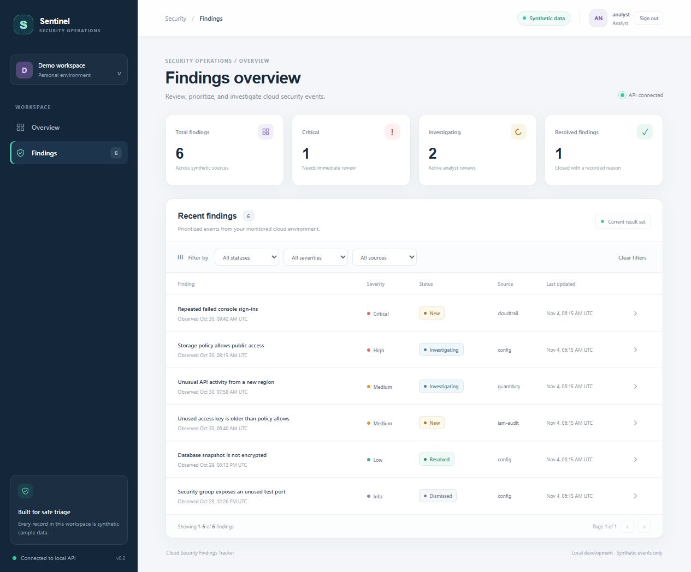
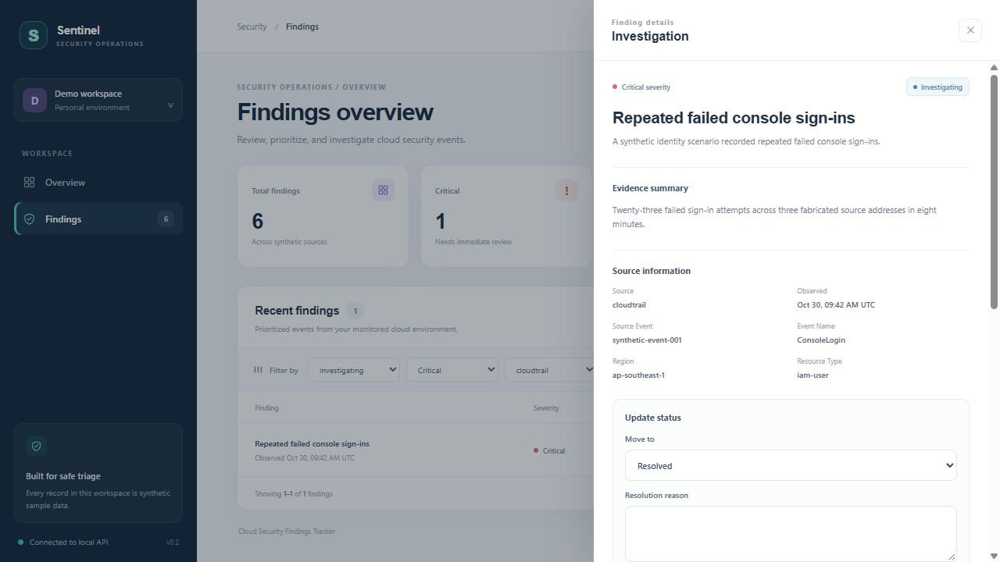
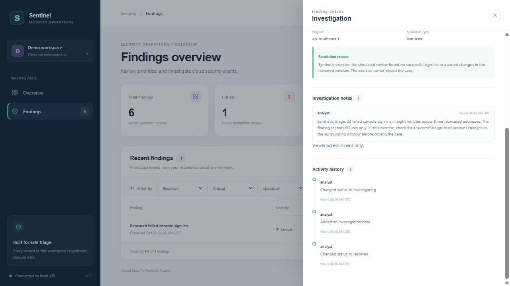

# Portfolio walkthrough

This three-minute demo follows one synthetic CloudTrail finding from the dashboard to a recorded decision and a read-only audit review. To reproduce it, follow the [investigation playbook](investigation-playbook.md) with a fresh local seed.

## 0:00–0:45 · Prioritize the queue

Sign in as the analyst. Point out the **Synthetic data** badge, the six seeded findings, and the one critical finding. Set Status to **New**, Severity to **Critical**, and Source to `cloudtrail`. Once the results settle, open **Repeated failed console sign-ins**.

## 0:45–2:00 · Record the investigation

Show the evidence summary and event ID `synthetic-event-001`. The sample records 23 failed attempts in eight minutes. A successful sign-in would require separate evidence. Move the finding to **Investigating** and add the playbook note about what to check next. Use the playbook's explicitly simulated review outcome to demonstrate **Resolved** with a written reason.

## 2:00–3:00 · Verify the audit trail

Sign out, sign in as the viewer, and filter for **Resolved**. Reopen the same finding. Show the reason, the analyst's note, and the three activity entries in order. The viewer can read them and sees **Viewer access is read-only**. The API enforces that role, and status and note changes are recorded with their audit events in the same transaction.

## How the screenshots were captured

The screenshots are from the running React and Flask app with all six repository seed records and disposable local analyst and viewer accounts. This browser run used in-memory SQLite. The [Compose setup](../README.md#start-the-local-application) uses PostgreSQL, and the [production image verification guide](production-images.md) covers the separate HTTPS and database TLS checks.
